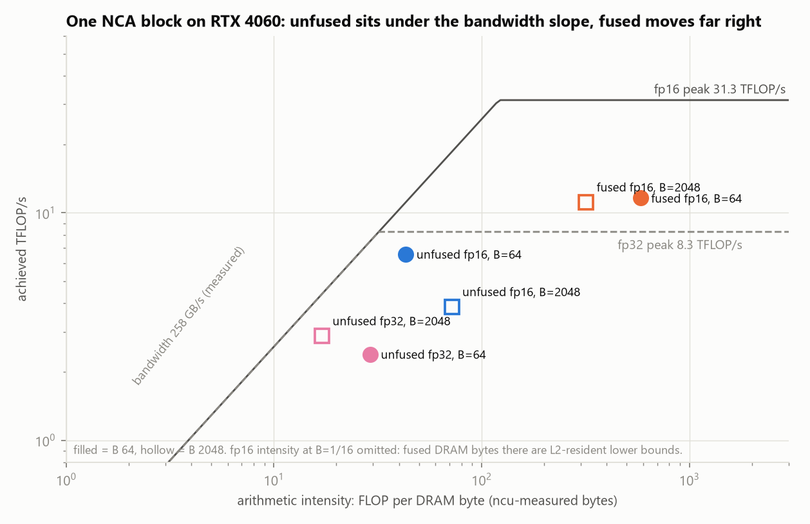
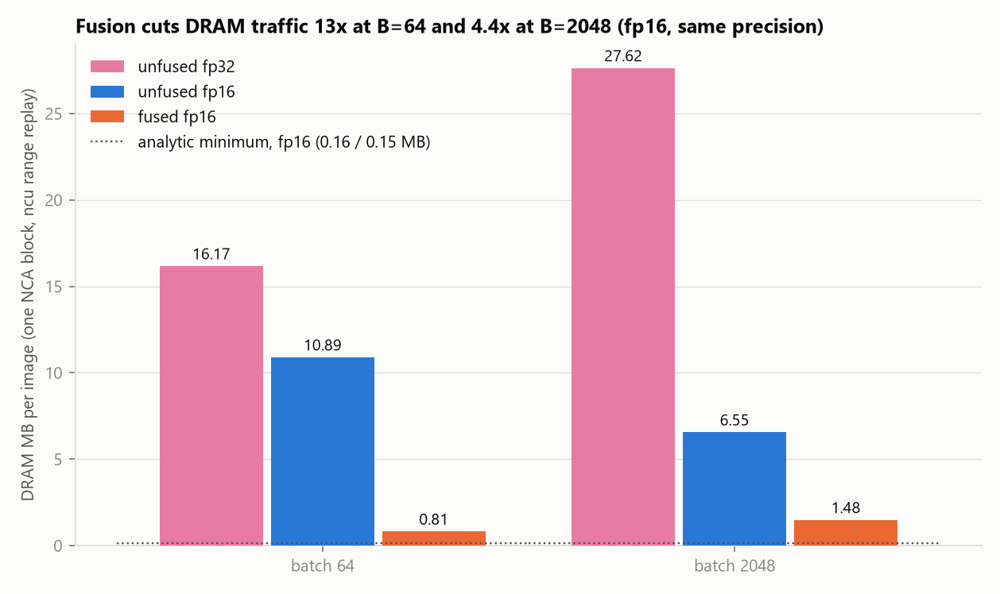
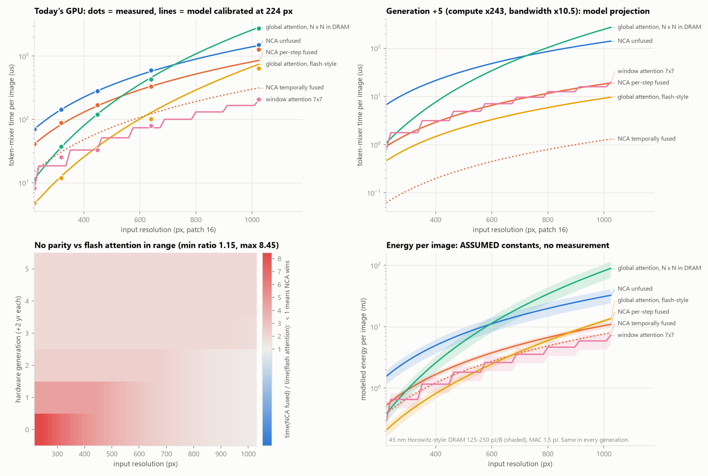

# Locality-aware execution of Neural Cellular Automata under the memory wall

**Question.** How much of an NCA token-mixer's runtime and DRAM traffic is caused by materialised intermediates, how much does kernel fusion remove, and under the memory wall (compute +3.0x / bandwidth +1.6x per 2-year generation, [Gholami et al.](https://arxiv.org/abs/2403.14123)) does local mixing ever match global or window attention?

**Hardware.** NVIDIA RTX 4060 (Ada, sm_89, 24 SMs, 24 MB L2, 8 GB, driver 610.88), Windows 11, PyTorch 2.9.1+cu128, `triton-windows` 3.5.1, Nsight Compute 2024.1. Measured peaks on this GPU: **258 GB/s**, **31.3 TFLOP/s** fp16 tensor, **8.3 TFLOP/s** fp32 (`peaks.py`). The project brief said "RTX 3050"; the machine is a 4060 and everything here was run on it.

The study was pre-registered ([`PREREGISTRATION.md`](PREREGISTRATION.md), committed before any measurement). Deviations and corrections are in its numbered Amendments, not hidden.

## Results

All block-level numbers are one NCA mixer (LayerNorm + K=4 update steps) with the trained weights, **fp16 vs fp16** unless stated, median of 3 process launches (CUDA events, 20 warm-up, 100 timed). DRAM bytes: Nsight Compute, whole forward as one range, caches not flushed.

| | unfused (original code) | per-step fused (Triton) | change |
|---|---|---|---|
| GPU operations per block (unfused: 35 kernels + 7 memsets/copies; fused: 6 kernels) | 42 | 6 | 7x fewer |
| **B=64**: time per block | 4.57 ms | 2.59 ms | **1.76x faster** |
| **B=64**: DRAM per image | 10.89 MB | 0.81 MB | **13.5x less** |
| B=64: DRAM / analytic minimum (0.16 MB) | 68x | 5.1x | |
| B=2048: time per block | 249 ms | 86 ms | 2.9x faster |
| B=2048: DRAM per image | 6.55 MB | 1.48 MB | 4.4x less |
| B=1: time per block | 1.58 ms | 0.34 ms | 4.7x (launch-bound regime) |
| Achieved fp16 throughput, B=64 | 6.6 TFLOP/s | 11.6 TFLOP/s | |

Whole hybrid model (6 NCA + 6 attention blocks), CIFAR-100, B=64:

| | img/s | CIFAR-100 top-1 |
|---|---|---|
| original, fp32 | 510 | 81.27% |
| original, fp16 | 1,589 | 81.27% |
| **fused, fp16** | **2,201** (1.39x vs fp16, 4.3x vs fp32) | **81.27%** (delta 0.00; 99.99% prediction agreement) |
| DeiT-Tiny fp16 / fp32 (random weights, timing only) | 5,271 / 1,790 | n/a |

The fused hybrid is still **0.42x DeiT-Tiny** at fp16. NCA mixers were 68% of the fp16 model's time (73% at fp32) and are still 55% after fusion; `nn.MultiheadAttention(need_weights=True)` blocks are only 10-13%, so that confound is small.

Token mixer alone, fp16, µs per image on this GPU (`bench_mixers.py`):

| resolution | NCA unfused | NCA fused | global attn (N x N in DRAM) | global attn (flash) | window 7x7 |
|---|---|---|---|---|---|
| 224 | 70 | 41 | 11 | 4.8 | 8.2 |
| 448 | 282 | 168 | 119 | 32 | 33 |
| 640 | 597 | 330 | 430 | 102 | 80 |
| 1024 | 1503 | 1268 | 2737 | 636 | 208 |

### Answers

1. **Materialised intermediates are the main cost of the unfused block, but not all of it.** At B=64 the unfused block moves 68x its minimum DRAM traffic; removing 93% of it (and 36 of 42 GPU operations) removes 43% of runtime (65% at B=2048). The share of that attributable to bytes alone versus launches and layout copies is **not separated** here; at B=1 launch overhead dominates (B=1 and B=16 take the same time on the reference).
2. **After fusion the block is no longer memory-bound** (about 20 GB/s of 258 GB/s used at B=64; 37% of the fp16 compute roof) and is limited by occupancy and latency (255 registers per thread). Remaining headroom is in the kernel, not in further data-movement work.
3. **Memory wall.** Calibrated at 224 px, the cost model predicts held-out mixer times with mean error 8%. In it, **per-step-fused NCA never reaches parity with flash-style global attention anywhere in 224-1024 px over 5 generations** (closest ratio 1.15x); measured on this GPU it does not either (it does beat attention that materialises the N x N matrix from 640 px, and the model says that threshold falls to 224 px by generation +3). An *ideal-roofline* model (every kernel at 100% of its roof) would give parity at 848 px for generations +0..+2 and none from +3, when both mixers become memory-bound and the gap freezes at the byte ratio. So the result is conditional on the efficiency of the kernels measured here, and fusing across steps (2 N D bytes instead of 12) is the lever that would change it ([Fig 3](results/fig3_projection.png)). It was not built (see Limitations).

### Figures

| | |
|---|---|
|  | Roofline: every measured configuration placed with measured DRAM bytes and achieved FLOP/s. |
|  | DRAM bytes per image before and after fusion. |
|  | Projected time (today and generation +5), NCA/flash-attention ratio over resolution x generation, assumed-constant energy. |

## Pre-registered hypotheses, scored

| H | Claim | Outcome |
|---|---|---|
| H1 | Unfused DRAM traffic >= 3x minimum at B=64 (stop if <= 1.5x) | **Supported**: 50x (fp32), 68x (fp16). GO. |
| H2 | Traffic amplification grows with batch (L2 absorbs small batches) | **Supported**: B=1 1.5-2.6x (protocol-sensitive), B=64 50x. Not monotone at larger B (not explained). |
| H3 | Fusion: >= 3x less traffic and R in [1.5, 4.5] (falsified if R > 6) | Reduction **supported** (13.5x at B=64). R bracket **missed** (5.06); R = 9.8 at B=2048, so **falsified there** by the strict rule. The wrapper (LayerNorm, zero-fill, init re-read) is part of that. |
| H4 | Fused block >= 1.5x faster at B=64 | **Supported**: 1.76x. (First kernel version was 10x slower; see Amendment 4.) |
| H5 | NCA share >= 40%; end-to-end >= 1.2x; accuracy within 0.1 pt; still slower than DeiT-Tiny | **All supported**: 68% / 1.39x / 0.00 / 0.42x. |
| H6 | Temporal fusion only if it fits and pays | **NO-GO by arithmetic** before coding (Amendment 5): upper bound 1.07-1.14x, needs explicit shared memory. |
| H7 | Parity predictions A, B, C | A, B **supported**; C's conclusion held, its stated mechanism was wrong (Amendment 7). |

## Limitations (read these)

- **Per-step fusion only.** State is read and written once per update step, not kept on-chip across the K=4 steps. Temporal fusion / halo tiling was analysed and rejected for this GPU; nothing here supports on-chip state across iterations.
- **One GPU, one model size** (D=192, 14x14 grid). Throughput comparisons with DeiT-Tiny use random weights (timing only).
- **Fused-kernel DRAM at B=1 and B=16 is a lower bound** (state stays in L2, dirty lines not yet written back when the range ends); only B >= 64 is used in claims. Analytic minimum is a cold-start floor, so ratios below 1 are possible for small batches.
- **`ncu` protocol.** Application replay did not finish at B=64 (26 min, no result); range replay is the main protocol, validated against application replay at B=16 (8-17% apart). At B=1 the two disagree strongly because of warm L2; both are reported. Cache-flushing replay is neither an upper nor a lower bound (Amendment 2).
- **Cost model**: bytes assume every intermediate lives in DRAM; one efficiency factor per mixer, fitted at 224 px; 3 of 20 held-out points exceed 25% error (listed in Amendment 7); the window-attention curve is sawtoothed because of modelled 7x7 padding.
- **Energy is not measured.** NVML energy and power counters are unsupported on this GPU. Energy results use assumed 45 nm constants (DRAM from the Horowitz text; the 1.5 pJ per fp16 MAC is an *unverified* recollection of a figure in the paper, sensitivity 10 pJ), identical in every generation by construction.
- **Accuracy.** 81.27% top-1 was measured here for the checkpoint your results file lists at 81.91%; the 0.64-point gap is unexplained. The fused-vs-original comparison is unaffected.
- fp32 B=64 timing is noisy (IQR up to 3 ms in one launch); the fp16 numbers are stable (IQR < 3%).
- Fused correctness: 23/24 cases pass the strict pre-registered bar (the failure is 1.12x the fp16 reference's max-abs error, one fp16 ulp at that magnitude; mean error is lower than the fp16 reference in 24/24).
- A property of the original model, not of this work: `F.conv2d(groups=D)` with 3 filters per channel assigns output channel `j` to input channel `j // 3`, so the initial sobel_x / sobel_y / identity filters are not applied as "all three to every channel" (Amendment 1).

## What the resume bullet may say

Not supported: "keeps cellular-automaton state in on-chip SRAM across all update iterations through halo tiling". Supported by measurements:

> Fused the NCA update step (3x3 depthwise perception, per-cell MLP, residual) into one Triton kernel that keeps the perception and hidden tensors in registers: 42 to 6 GPU operations per block, 13.5x less DRAM traffic and 1.76x faster at batch 64 (fp16), 1.39x higher end-to-end throughput on a CIFAR-100 hybrid ViT with unchanged accuracy (81.27% top-1). Analysed temporal fusion across update steps (shared-memory footprint, halo redundancy, roofline bound) and showed it cannot pay off on this GPU.

## Reproduce

Windows, Python 3.11, an NVIDIA GPU, Nsight Compute with counter access enabled (admin terminal or "allow access to the GPU performance counters to all users"). Paths to the research repo and checkpoints are set at the top of `reference.py` and `e2e.py`.

```
python -m venv .venv && .venv\Scripts\pip install -r requirements.txt   # torch needs --index-url https://download.pytorch.org/whl/cu128
python reference.py                      # reference == original NCAAttention (bit-exact)
python bench_block.py                    # M1 timing           -> results/m1_timing.json
python run_ncu.py --impl ref --dtypes fp32 --out m1_dram_fp32.json   # M1 DRAM (ncu), likewise fp16 / B=2048 (see results/*.log)
python analyze_m1.py
python test_fused.py                     # M2 correctness      -> results/m2_correctness.json
python bench_block.py --impl fused       # M2 timing
python run_ncu.py --impl fused --dtypes fp16 --out m2_dram_fused.json
python analyze_m2.py
python peaks.py && python m3_analysis.py # measured peaks, M3 go/no-go
python e2e.py acc && python e2e.py bench # M4 accuracy / throughput
python bench_mixers.py && python cost_model.py   # M5
python plot_results.py && python make_summary.py # figures, results/summary.json
```

`results/` holds every raw output (JSON + logs). `EXPLAIN.md` is a teaching walkthrough with a 10-question quiz.
